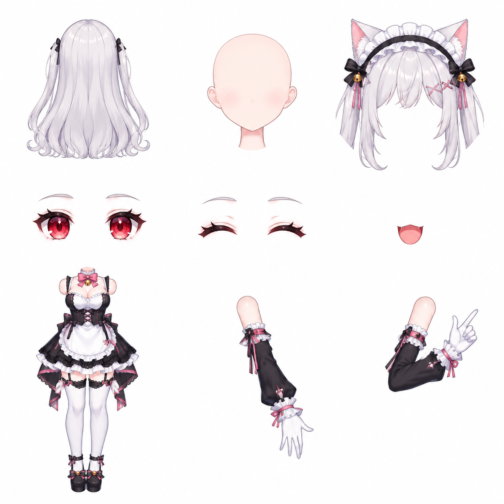
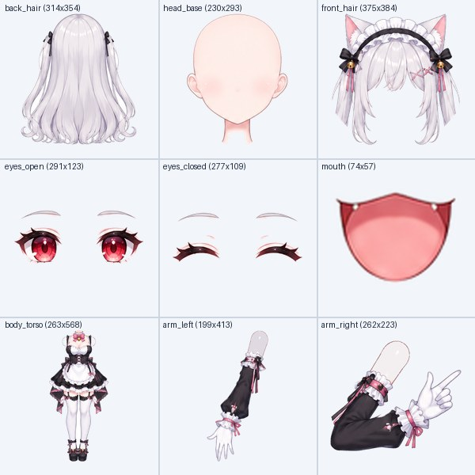

# banano2live2D ??????

> **??????????? + ????????????? Live2D ???**  
> ???? **?????? Live2D (??? Text-to-Live2D)?** ? **?????? Live2D (??? Image-to-Live2D)?**?  
> ???? **??? 3?3 ??????????+???????? & BFS ???????**?  
> ???? **?????????? + ??????? (.motion3.json) ???**?  
> ??????????(Azur Lane `banerwei_3`) ?? 28 ???4 ??????? 19+ ??????????? Web Studio ???

[](LICENSE)
[](https://www.python.org/)
[](web/index.html)
[](https://hrioapi.hrio.site)

---

## ?? ???? (Demo Showcase)

> ???????????????  
> `??????????????????????????????????????????????????`

| 1. `gemini-nano-banana-2.1` ?? 3?3 ??????? | 2. ????? + BFS ???? 9 ????? | 3. `gemini-3.8-flash` ??????????? |
| :---: | :---: | :---: |
|  |  |  |

---

## ?? ?????????????????

???????? 3D ?????????????????? **????? (`gemini-nano-banana-2.1`) + ?????????? + ???????? (`gemini-3.8-flash`)** ???????

### Step 1????????? (`gemini-nano-banana-2.1`) ???? 3?3 ??????
* **????? (Text-to-Image)**??????????100% ????????????????????????
* **????? (Image-to-Image)**???????/?????????????????????? 3?3 ??????
* **?? 9 ??????**?
  * `[0,0] hair_back`?????? | `[0,1] body_torso`???????????? | `[0,2] head_base`??????????????
  * `[1,0] arm_left`????????? | `[1,1] arm_right`????????? | `[1,2] face_eyes`???? + ?? + ????
  * `[2,0] face_mouth_brows`??? + ????? | `[2,1] hair_front_side`???? + ????? | `[2,2] accessories`???/??/??/?????

### Step 2?????????? + BFS ???????? (`banano2gif` + `see-through-main`)
* **????????? (`cutter/slicer.py`)**?? 1/3?2/3 ??????????????????????????
* **BFS ???????? + ?? Halo ???? (`cutter/cleaner.py`)**??? `see-through-main` ??? Alpha ???????????????????? `2048?2048` ???? `textures/texture_00.png` ? 9 ??????? `matted_contact_sheet.jpg`?

### Step 3?????????? (`gemini-3.8-flash`) ???? + ???????
* ? **???? 9 ??????? + ??????? + ???????** ????? `gemini-3.8-flash`?
  1. **???? (`rig_spec`)**???????????????????? `(anchor_x, anchor_y, scale)`????? `(pivot_x, pivot_y)`????? `z_order` ??????
  2. **??????? (`custom_motions`)**?????????????????????????????????????????????????????? `.motion3.json` ?????

### Step 4?????????????(`banerwei_3`) ?? Live2D ???????
* `<name>.model3.json`?? `HitAreas`: `Head` / `Special` / `Body`??? `EyeBlink` / `LipSync` ????
* `<name>.cdi3.json`?28 ??????? + 15 ? Part ???
* `<name>.physics3.json`?4 ??????????????????????
* `motions/*.motion3.json`?19 ??? Cubic Bezier ?? + ??????? `custom_*.motion3.json`?

---

## ?? ????? API Key

?????????? SDK??? **HrioAPI** ????? `gemini-nano-banana-2.1` ? `gemini-3.8-flash`??

1. ???????? API Key??? **[https://hrioapi.hrio.site](https://hrioapi.hrio.site)**
2. ???????? `.env` ??????????
   ```bash
   # Windows PowerShell
   $env:HRIO_API_KEY="sk-xxxxxxxxxxxxxxxx"

   # Linux / macOS
   export HRIO_API_KEY="sk-xxxxxxxxxxxxxxxx"
   ```

---

## ??? ???? (Quick Start)

### ????????? Web Studio????

```bash
pip install -r requirements.txt
python main.py studio --port 8090
```

??????????**http://127.0.0.1:8090**

* **????? Live2D**????????????????????????????`?????????????????????????`???? **??? 1.?? ? 2.?? ? 3.???????? ? ???**?
* **????? Live2D**??? **??? ??????** ???????????? `??? (Image-to-Image)` ???????????????
* **??????**?????? **??? ???? Live2D ?? (.zip)?** ?????? `.model3.json`?`.physics3.json`?`.cdi3.json`?`motions/*.motion3.json` ? `parts/*.png` ???????

### ??????? CLI ??

```bash
# 1. ??????? Live2D ???????
python main.py create -p "???????????????????????" -n catmaid -o output/catmaid --serve

# 2. ??? (???) ?? Live2D ??
python main.py create -i "my_character.png" -p "????????????????????" -n my_char -o output/my_char

# 3. ???? 3?3 ???????????????
python main.py from-grid examples/catmaid_3x3_sheet.jpg -n catmaid -o output/catmaid
```

---

## ?? ??????

```text
banano2live2D/
??? banano2live2D/
?   ??? sdk/client.py           # ?? HrioAPI ?????? (gemini-nano-banana-2.1 & gemini-3.8-flash)
?   ??? prompts/engine.py       # 3?3 ???????? Prompt ?????????????
?   ??? cutter/
?   ?   ??? slicer.py           # ??????? 3?3 ????
?   ?   ??? cleaner.py          # BFS ???????Halo ??? 2048 ??????
?   ?   ??? matting.py          # ????? Alpha ????
?   ??? rigger/
?   ?   ??? gemini_rigger.py    # gemini-3.8-flash ???? + ?????????
?   ?   ??? motion_builder.py   # 19 ????? + ??????? (.motion3.json) ???
?   ?   ??? model_builder.py    # .model3.json / .cdi3.json / .physics3.json ???
?   ??? viewer/
?       ??? studio_server.py    # ???????????? ZIP ??????
??? web/index.html              # ??? Live2D Studio ???? (2.5D ???? + ?????)
??? examples/                   # ????????????????????
??? main.py                     # CLI ??
??? requirements.txt            # ???? (Pillow, NumPy)
```

---

## ?? License

????? [MIT License](LICENSE) ???
