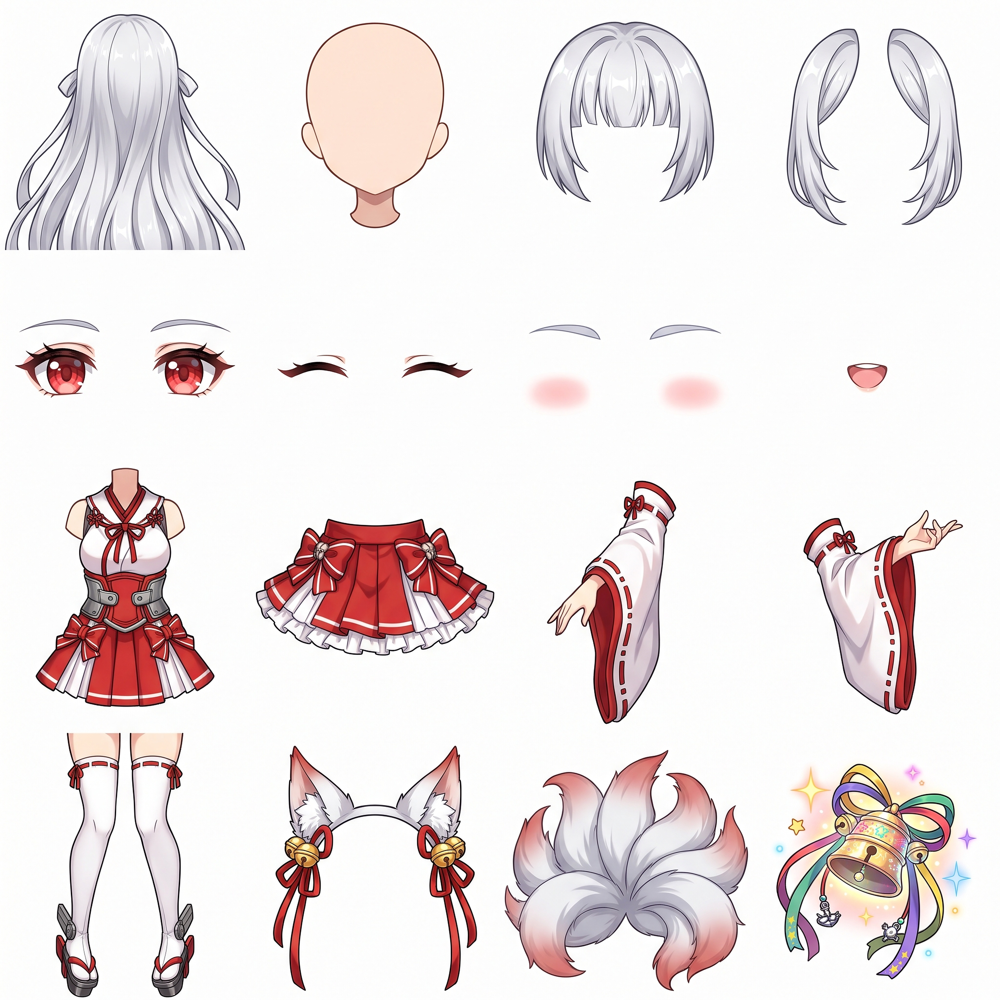
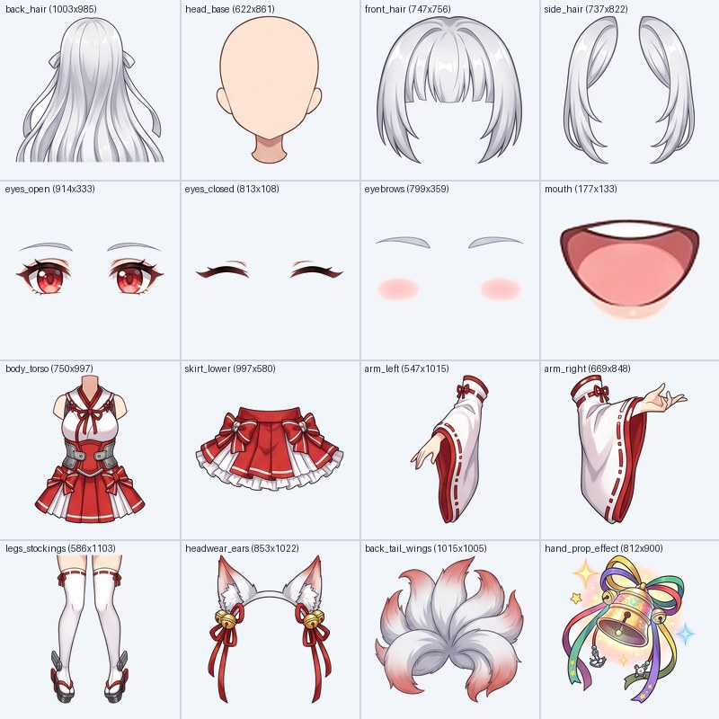

# banano2live2D 🍌➡️🎭

> **轻量级双模型驱动（生图 + 多模态视觉文本模型）组件化 Live2D 生成器**  
> 原生支持 **【纯文本生成 Live2D (文生图 Text-to-Live2D)】** 与 **【参考图生成 Live2D (图生图 Image-to-Live2D)】**！  
> 原生支持 **【4×4 十六宫格 (16 灵活组件) + 4K 超清 (4096×4096 UHD)】** 与 **【3×3 九宫格 (9 标准组件)】** 双规格！  
> 原生支持 **【自适应波谷切分 & BFS 边缘去底抠图】+【多模态模型视觉配准 + 用户自定义动作 (.motion3.json) 生成】**！  
> 全面对齐《碧蓝航线》(Azur Lane `banerwei_3`) 标准 28 参数、4 节点物理摆动与 19+ 组动作规范，内置交互式 Web Studio 舞台！

[](LICENSE)
[](https://www.python.org/)
[](web/index.html)
[-ff69b4.svg)](#)
[](https://hrioapi.hrio.site)

---

## 🌟 效果展示 (Demo Showcase)

### 1️⃣ 4×4 十六宫格（16 灵活组件）+ 4K 超清（4096×4096 UHD）实测效果

> 示例输入提示词（4×4 + 4K 纯文本模式）：  
> `“重樱神社九尾白狐巫女，银白色长发，金色铃铛狐耳发饰，红色渐变瞳孔，红白露肩巫女服与红色百褶裙，白色过膝长袜，身后蓬松九尾，右手拿着发光神乐铃。请增加一个摇晃九尾撒娇的动作，以及一个挥舞神乐铃祈福跳舞的动作。”`

| 1. `gemini-nano-banana-2.1` 生成 4×4 4K (4096×4096) 十六宫格拆件图 | 2. 自适应切分 + BFS 去底抠图 16 部件总览图 | 3. `gemini-3.8-flash` 16 部件视觉配准与动作装配成品 |
| :---: | :---: | :---: |
|  |  |  |

### 2️⃣ 3×3 九宫格（9 标准组件）实测效果

> 示例输入提示词（3×3 纯文本模式）：  
> `“银白发红瞳猫耳女仆，黑色蕾丝围裙女仆装，粉色蝴蝶结铃铛项圈，增加一个开心地跳起来挥手打招呼的动作”`

| 1. `gemini-nano-banana-2.1` 生成 3×3 语义组件九宫格 | 2. 自适应切分 + BFS 去底抠图 9 部件总览图 | 3. `gemini-3.8-flash` 视觉配准与动作装配成品 |
| :---: | :---: | :---: |
|  |  |  |

---

## 🚀 核心流水线：四步顺序组件化生成架构

本项目不依赖重型 3D 渲染管线或商业编辑器，核心生成完全由 **生图大模型 (`gemini-nano-banana-2.1`) + 轻量几何切分抠图算法 + 视觉多模态大模型 (`gemini-3.8-flash`)** 严格按序驱动：

### Step 1️⃣：调用生图模型 (`gemini-nano-banana-2.1`) 生成单张 4×4 十六宫格（或 3×3 九宫格）4K 组件大图
* **文生图模式 (Text-to-Image)**：未上传图片附件时，100% 忠实根据用户输入的文本提示词生成角色拆件大图；
* **图生图模式 (Image-to-Image)**：上传角色立绘/人设参考图后，锁定参考图的角色外观特征拆解为独立语义部件；
* **4K 超清模式 (`is_4k=True`, `4096×4096`)**：请求 `4096×4096` 超清大图，每个独立部件拥有充足像素密度；
* **4×4 十六宫格（16 灵活部件）语义分区**：
  * **第 1 行（头部与发丝）**：`[0,0] back_hair`（后发主体） | `[0,1] head_base`（无五官素体头颈） | `[0,2] front_hair`（中空前刘海） | `[0,3] side_hair`（左右侧发鬓角）
  * **第 2 行（五官表情）**：`[1,0] eyes_open`（常开双眼） | `[1,1] eyes_closed`（微笑闭眼） | `[1,2] eyebrows`（独立双眉） | `[1,3] mouth`（嘴型部件）
  * **第 3 行（躯干、裙摆与双臂）**：`[2,0] body_torso`（无臂上衣躯干） | `[2,1] skirt_lower`（高飘裙摆下装） | `[2,2] arm_left`（独立左臂） | `[2,3] arm_right`（独立右臂）
  * **第 4 行（双腿、头饰、背饰与手持道具）**：`[3,0] legs_stockings`（双腿长袜鞋履） | `[3,1] headwear_ears`（头饰/兽耳/光环） | `[3,2] back_tail_wings`（背后尾巴/翅膀/舰装） | `[3,3] hand_prop_effect`（手持道具/武器/特效）

### Step 2️⃣：自适应波谷切分 + BFS 洪水填充去底抠图 (`banano2gif` + `see-through-main`)
* **自适应投影波谷切分 (`cutter/slicer.py`)**：自动识别 `3×3`（1/3、2/3）或 `4×4`（1/4、2/4、3/4）像素墨水密度波谷定位分割线，防止截断发梢或袖口；
* **BFS 角落洪水填充去底 + 边缘 Halo 脱色净化 (`cutter/cleaner.py`)**：借鉴 `see-through-main` 的前景 Alpha 估计与连通域去噪，剥离纯白背景并自动打包生成 `2048×2048` / `4096×4096` 纹理图集 `textures/texture_00.png` 与部件编号总览图 `matted_contact_sheet.jpg`。

### Step 3️⃣：调用多模态模型 (`gemini-3.8-flash`) 视觉配准 + 自定义动作生成
* 将 **抠图后的 9/16 部件编号总览图 + 各组件像素尺寸 + 用户原始提示词** 统一发送给 `gemini-3.8-flash`：
  1. **视觉配准 (`rig_spec`)**：自动推理每个部件在 `1000×1000` 立绘画布上的装配坐标 `canvas_center`、缩放比例 `scale`（自动适配 1K/2K/4K 像素尺寸）、旋转枢轴 `pivot` 与深度顺序 `z_index`；
  2. **自定义动作算法 (`custom_motions`)**：当用户在提示词中要求增加特定动作（如“摇晃九尾撒娇”、“挥舞神乐铃祈福跳舞”）时，自动合成对应的多关键帧动画曲线并编译为 `.motion3.json` 动作文件。

### Step 4️⃣：生成完整《碧蓝航线》(`banerwei_3`) 规范 Live2D 工程与交互舞台
* `<name>.model3.json`（含 `HitAreas`: `Head` / `Special` / `Body`，以及 `EyeBlink` / `LipSync` 参数组）
* `<name>.cdi3.json`（28 项标准控制参数 + 15+ 个 Part 分组）
* `<name>.physics3.json`（4 节点钟摆物理链：后发、前发、侧发、裙摆与配饰丝带）
* `motions/*.motion3.json`（19 组标准 Cubic Bezier 动作 + 用户自定义动作 `custom_*.motion3.json`）

---

## 🔑 获取与配置 API Key

本项目内置零依赖原生 SDK，直连 **HrioAPI** 平台（支持 `gemini-nano-banana-2.1` 与 `gemini-3.8-flash`）：

1. 前往官方网站获取 API Key：👉 **[https://hrioapi.hrio.site](https://hrioapi.hrio.site)**
2. 在项目根目录创建 `.env` 文件或设置环境变量：
   ```bash
   # Windows PowerShell
   $env:HRIO_API_KEY="sk-xxxxxxxxxxxxxxxx"

   # Linux / macOS
   export HRIO_API_KEY="sk-xxxxxxxxxxxxxxxx"
   ```

---

## 🖥️ 快速开始 (Quick Start)

### 方式一：启动交互式 Web Studio（推荐）

```bash
pip install -r requirements.txt
python main.py studio --port 8090
```

启动后在浏览器访问：**http://127.0.0.1:8090**

* **选择宫格与分辨率**：在界面左上角可自由选择 **`4×4 十六宫格 (16部件·高灵活度)`** 或 **`3×3 九宫格 (9部件·经典标准)`**，并勾选 **`🌟 4K 超清请求 (4096×4096 UHD)`**；
* **文生图生成 Live2D**：不上传附件，直接在对话框输入角色外貌与动作要求，点击 **「🚀 1.生图 ➔ 2.抠图 ➔ 3.文本模型生成动作 ➔ 装配」**；
* **图生图生成 Live2D**：点击 **「📎 上传参考图」** 上传角色图片，自动切换为 `图生图 (Image-to-Image)` 模式生成专属拆件图并完成装配；
* **一键导出工程**：点击右上角 **「📦 导出完整 Live2D 工程 (.zip)」** 下载包含全部 `.model3.json`、`.physics3.json`、`.cdi3.json`、`motions/*.motion3.json` 与 `parts/*.png` 的完整工程包。

### 方式二：命令行 CLI 生成

```bash
# 1. 4×4 十六宫格 + 4K 超清纯文本生成完整 Live2D 工程并启动预览
python main.py create -p "重樱神社九尾白狐巫女，增加摇尾撒娇与神乐祈福动作" -n fox_miko --grid 4x4 --4k -o output/fox_miko_4x4_4k --serve

# 2. 3×3 九宫格纯文本生成 Live2D 工程
python main.py create -p "银白发红瞳猫耳女仆，增加一个开心跳跃挥手的动作" -n catmaid --grid 3x3 -o output/catmaid

# 3. 参考图 (图生图) + 4×4 + 4K 生成 Live2D 工程
python main.py create -i "my_character.png" -p "保持角色外貌，拆解为16宫格并增加敬礼动作" -n my_char --grid 4x4 --4k -o output/my_char

# 4. 从已有的 4×4 或 3×3 拆件大图直接切分抠图并装配
python main.py from-grid examples/fox_miko_4x4_4k_sheet.jpg --grid 4x4 -n fox_miko -o output/fox_miko
```

---

## 📂 项目目录结构

```text
banano2live2D/
├── banano2live2D/
│   ├── sdk/client.py           # 原生 HrioAPI 双模型客户端 (支持 3x3/4x4 与 4K 4096x4096 超清生成)
│   ├── prompts/engine.py       # 3×3 九宫格与 4×4 十六宫格组件化拆件 Prompt 引擎（支持文生图与图生图）
│   ├── cutter/
│   │   ├── slicer.py           # 自适应投影波谷 3×3 & 4×4 切分算法
│   │   ├── cleaner.py          # BFS 洪水填充去底、Halo 净化与 2048/4096 纹理图集打包
│   │   └── matting.py          # 边缘羽化与 Alpha 通道提取
│   ├── rigger/
│   │   ├── gemini_rigger.py    # gemini-3.8-flash 9/16 部件视觉配准 + 自定义动作规格生成
│   │   ├── motion_builder.py   # 19 组标准动作 + 用户自定义动作 (.motion3.json) 编译器
│   │   └── model_builder.py    # .model3.json / .cdi3.json / .physics3.json 生成器
│   └── viewer/
│       └── studio_server.py    # 四步顺序流水线后端服务与 ZIP 工程导出接口
├── web/index.html              # 交互式 Live2D Studio 前端界面 (支持 4x4/3x3 + 4K UHD 2.5D 物理舞台)
├── examples/                   # 4x4 4K 与 3x3 示例拆件图、去底总览图与成品预览图
├── main.py                     # CLI 入口
└── requirements.txt            # 轻量依赖 (Pillow, NumPy)
```

---

## 📄 License

本项目基于 [MIT License](LICENSE) 开源。
